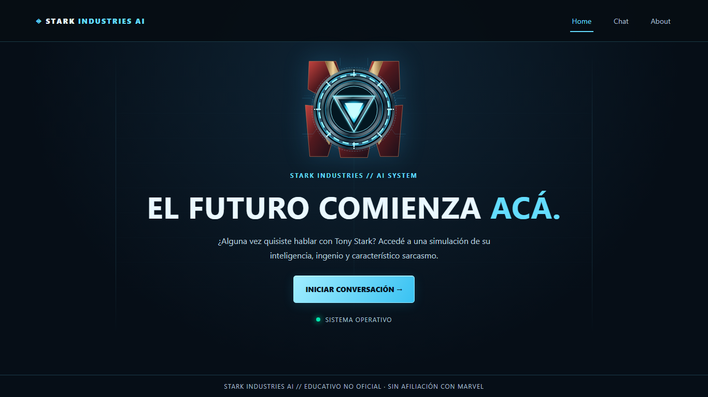
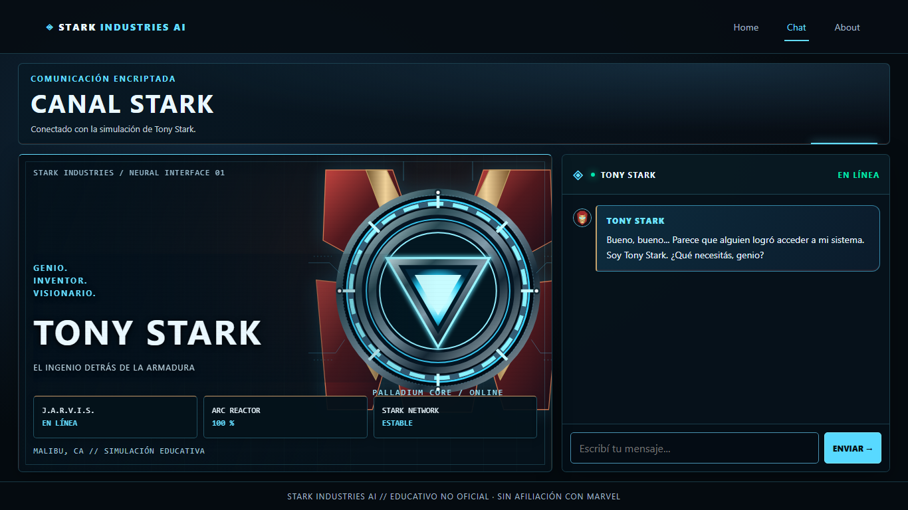
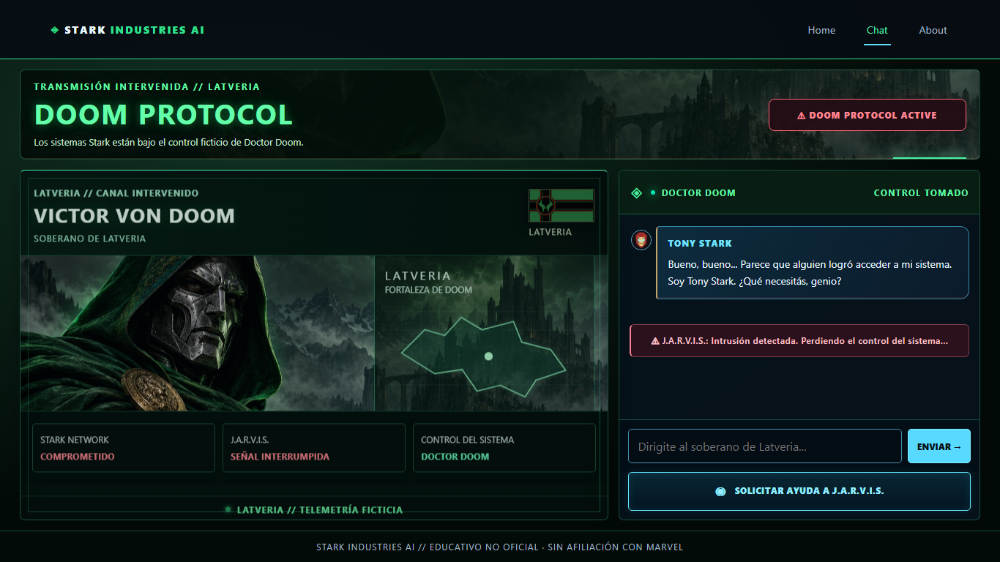
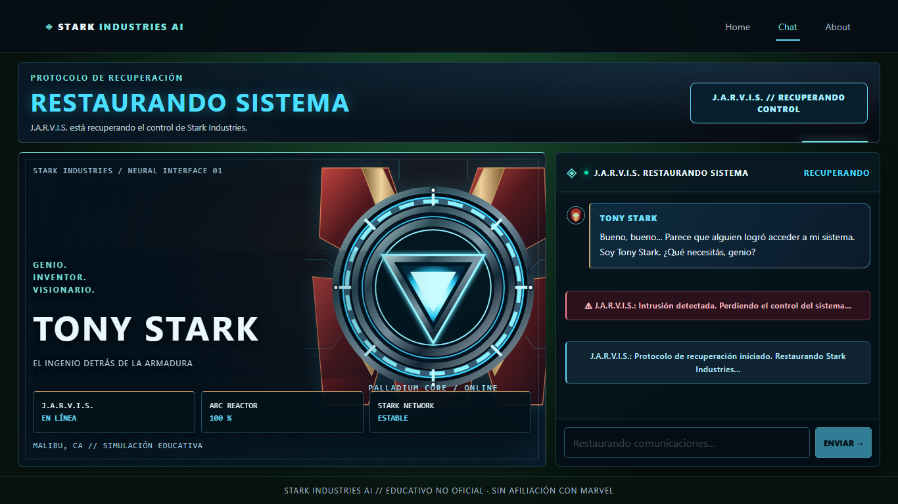
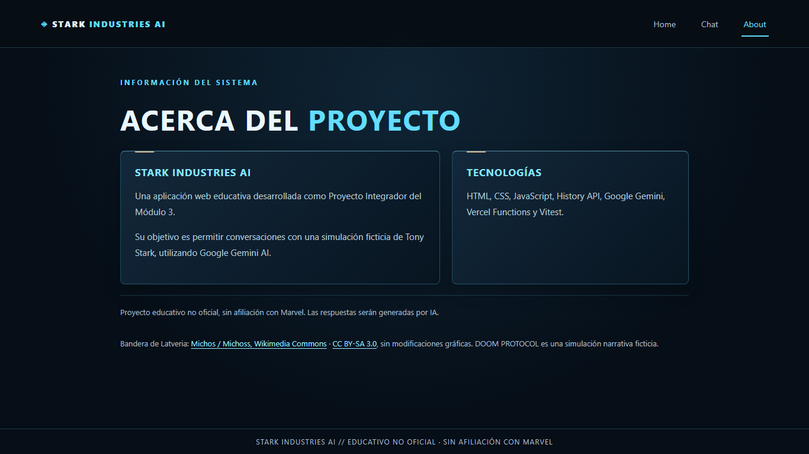
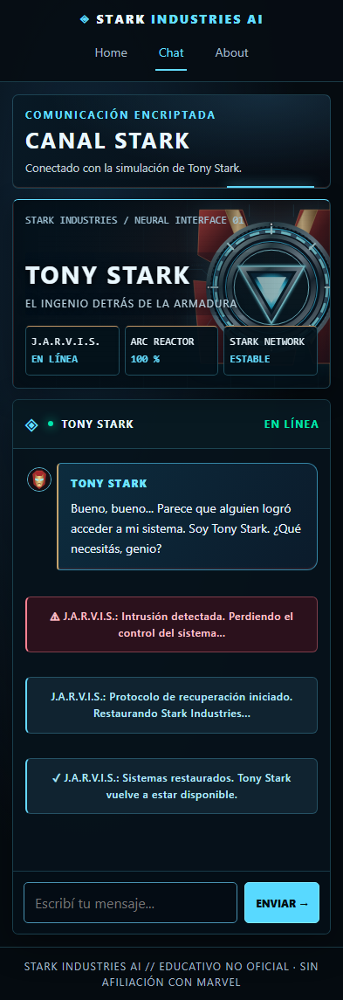

# ⚡ STARK INDUSTRIES AI

**Conversá con Tony Stark. Descubrí DOOM PROTOCOL. Recuperá el control con J.A.R.V.I.S.**

**[GitHub](https://github.com/Santiago-Sanchez01/stark-industries-ai-PI-M3)** · **[Producción](https://stark-industries-ai.vercel.app/)**

---

## 📖 Descripción del proyecto

**Stark Industries AI** es una Single Page Application (SPA) responsive desarrollada como Proyecto Integrador del Módulo 3 de Full Stack de Henry.

La aplicación permite conversar con una simulación de **Tony Stark (Iron Man)** utilizando Google Gemini AI.

Además, incorpora una experiencia interactiva llamada **DOOM PROTOCOL**, en la que Doctor Doom toma el control ficticio del sistema cuando el usuario menciona palabras relacionadas con el personaje o Latveria.

Durante este evento, la interfaz cambia completamente su identidad visual y permite conversar con Doctor Doom. El usuario puede solicitar ayuda a J.A.R.V.I.S. para recuperar el control y volver a conversar con Tony Stark.

El proyecto integra desarrollo frontend, navegación SPA, consumo de APIs, inteligencia artificial, funciones serverless, seguridad, testing y despliegue.

## 🚀 Funcionalidades principales

### 🤖 Chat con Tony Stark

- Conversaciones generadas mediante Google Gemini AI.
- Personalidad de Tony Stark definida mediante un system prompt.
- Respuestas contextualizadas según el historial.
- Diferenciación visual entre mensajes del usuario y de la IA.
- Indicador de escritura mientras se genera una respuesta.
- Envío de mensajes con Enter o mediante el botón Enviar.
- Scroll automático al último mensaje.
- Manejo de errores de conexión y de la API.
- Historial mantenido durante la sesión de la SPA.

### 🟢 DOOM PROTOCOL

DOOM PROTOCOL es una experiencia interactiva adicional que transforma la aplicación cuando el usuario menciona a Doctor Doom, Latveria o referencias relacionadas.

**Funcionamiento del evento:**

1. El usuario menciona a Doom durante una conversación.
2. El sistema detecta automáticamente la referencia.
3. Se activa una alerta de intrusión.
4. La interfaz cambia de la estética azul de J.A.R.V.I.S. a una identidad visual verde y roja.
5. Aparece la bandera de Latveria.
6. Doctor Doom toma el control ficticio del sistema.
7. Gemini comienza a responder utilizando la personalidad de Doctor Doom.
8. El usuario puede solicitar ayuda a J.A.R.V.I.S. mediante un botón.
9. Se ejecuta la recuperación y Tony Stark vuelve a controlar el chat.

Cada personaje utiliza un system prompt propio y un historial independiente, permitiendo mantener el contexto de las conversaciones.

La intrusión es completamente ficticia y forma parte de la experiencia narrativa.

### 🧭 Navegación SPA

La aplicación utiliza History API para implementar navegación sin recargar la página.

Cuenta con tres rutas:

- `/home`: página principal y presentación de la aplicación.
- `/chat`: interfaz de conversación con los personajes.
- `/about`: información del proyecto y las tecnologías.

También permite navegar correctamente utilizando los botones Atrás y Adelante del navegador.

### 📱 Diseño responsive

La interfaz fue desarrollada utilizando el enfoque Mobile-First.

Se aplicaron Flexbox, CSS Grid y media queries para adaptar el diseño a celulares, tablets y computadoras.

La aplicación fue probada exitosamente desde navegadores de escritorio y dos dispositivos móviles reales.

## 🛠️ Tecnologías utilizadas

| Tecnología | Función |
|---|---|
| HTML5 | Estructura de la aplicación |
| CSS3 | Estilos, responsive y animaciones |
| JavaScript ES6+ | Lógica y manipulación del DOM |
| Vite | Entorno de desarrollo y build |
| History API | Navegación SPA |
| Fetch API | Comunicación con el backend |
| Google Gemini AI | Generación de respuestas |
| Vercel Serverless Functions | Backend seguro |
| Vitest | Testing unitario |
| Git | Control de versiones |
| GitHub | Repositorio del proyecto |
| Vercel | Despliegue y alojamiento |

## 📂 Estructura del proyecto

```text
stark-industries-ai-PI-M3/
│
├── api/
│   └── functions.js
│
├── src/
│   ├── api.js
│   ├── app.js
│   ├── chat.js
│   ├── cinematic.css
│   ├── doomProtocol.js
│   ├── messageView.js
│   ├── styles.css
│   └── utils.js
│
├── tests/
│   ├── app.test.js
│   ├── doomProtocol.test.js
│   ├── messageView.test.js
│   └── utils.test.js
│
├── public/
│   ├── favicon.svg
│   ├── icons.svg
│   └── assets/
│       ├── arc-reactor.svg
│       ├── doom-cinematic.jpg
│       ├── doom-portrait.svg
│       ├── iron-avatar.svg
│       ├── stark-armor-exhibition.webp
│       ├── stark-laboratory.svg
│       └── latveria-flag.svg
│
├── docs/
│   ├── design-assets/
│   │   └── doom-cinematic-source.png
│   └── screenshots/
│       ├── home.png
│       ├── chat-tony.png
│       ├── doom-protocol.png
│       ├── recuperacion-jarvis.png
│       ├── about.png
│       └── mobile-chat.png
│
├── index.html
├── .env.example
├── .gitignore
├── package.json
├── package-lock.json
├── vercel.json
└── README.md
```

### Responsabilidad de los archivos

- **app.js:** renderizado de las vistas y navegación SPA.
- **chat.js:** manejo de mensajes, historial e interacción con el usuario.
- **api.js:** comunicación HTTP entre frontend y backend.
- **doomProtocol.js:** estados, activación y recuperación del protocolo.
- **messageView.js:** construcción segura de mensajes, avatares y avisos por autor.
- **styles.css / cinematic.css:** estilos generales y composición cinematográfica responsive.
- **public/assets/:** recursos visuales locales; créditos y licencias al final del documento.
- **docs/screenshots/:** capturas reales de la aplicación local.
- **utils.js:** funciones de normalización y transformación de datos.
- **api/functions.js:** función serverless que consulta Google Gemini.
- **tests/:** pruebas automatizadas mediante Vitest.

## 💻 Instalación y ejecución local

### Requisitos previos

Para ejecutar el proyecto es necesario contar con:

- Node.js y npm compatibles con las dependencias del proyecto.
- Git.
- Una cuenta de Vercel.
- Una API key válida de Google Gemini.
- Visual Studio Code u otro editor de código.

### 1. Clonar el repositorio

```bash
git clone https://github.com/Santiago-Sanchez01/stark-industries-ai-PI-M3.git
```

Ingresar a la carpeta:

```bash
cd stark-industries-ai-PI-M3
```

### 2. Instalar dependencias

```bash
npm install
```

### 3. Instalar Vercel CLI

```bash
npm install -g vercel
```

### 4. Configurar las variables de entorno

La aplicación utiliza una variable privada llamada:

```env
GEMINI_API_KEY=
```

La clave puede obtenerse desde:

https://aistudio.google.com/apikey

Configurar `GEMINI_API_KEY` en el entorno Development del proyecto de Vercel.

Iniciar sesión:

```bash
vercel login
```

Vincular el proyecto:

```bash
vercel link
```

Sincronizar las variables de entorno:

```bash
vercel pull --yes --environment=development
```

**Importante:** nunca colocar la clave real en los archivos del frontend ni subirla a GitHub.

El archivo `.env.example` documenta las variables necesarias sin incluir valores sensibles.

### 5. Iniciar el proyecto

```bash
vercel dev
```

Abrir la dirección local indicada por la terminal, generalmente:

http://localhost:3000

Se utiliza `vercel dev` porque permite ejecutar tanto el frontend desarrollado con Vite como las Vercel Serverless Functions.

`vercel dev` es un comando de Vercel CLI, no un script de `package.json`. Para revisar únicamente la interfaz con Vite:

```bash
npm run dev
```

Vite por sí solo no ejecuta `/api/functions`; para conversar con Gemini en desarrollo usá `vercel dev` con la variable privada configurada. `npm run preview` permite inspeccionar el frontend compilado después del build, sin ejecutar las funciones serverless.

En PowerShell, si la política de ejecución bloquea `npm.ps1`, los mismos comandos pueden ejecutarse con `npm.cmd`.

## 🧠 Integración con Google Gemini AI

La aplicación utiliza una arquitectura frontend-backend para proteger la API key.

**Flujo de comunicación:**

1. El usuario escribe un mensaje.
2. `chat.js` administra la conversación.
3. `api.js` realiza una petición POST al endpoint `/api/functions`.
4. La Serverless Function recibe el historial y el personaje seleccionado.
5. El backend selecciona el system prompt correspondiente.
6. La función consulta Google Gemini utilizando la API key privada.
7. Gemini genera una respuesta.
8. El backend procesa el JSON y devuelve el texto.
9. El frontend muestra la respuesta en el chat.

### Personalización de personajes

**Tony Stark**

Su personalidad se basa en inteligencia, creatividad, confianza, humor sarcástico y conocimientos de tecnología e ingeniería.

**Doctor Doom**

Su personalidad se caracteriza por autoridad, orgullo, inteligencia, arrogancia y referencias a Latveria.

Cada personaje mantiene su propio historial conversacional para evitar mezclar contextos.

El historial se conserva en memoria durante la sesión de la SPA y se reinicia al recargar completamente la aplicación.

## 🧪 Testing unitario

Se utiliza **Vitest** para verificar el funcionamiento de las funciones principales de la aplicación.

Los tests comprueban:

- Normalización de mensajes.
- Transformación de mensajes al formato de Gemini.
- Validación de roles.
- Extracción de respuestas desde JSON.
- Comunicación HTTP mediante Fetch API.
- Manejo de errores del backend.
- Selección de Tony Stark.
- Selección de Doctor Doom.
- Transiciones NORMAL → ALERT → DOOM → RECOVERY → NORMAL y visibilidad de la recuperación.
- Identidad visual por autor y tipos de avisos de intrusión y recuperación.

Las solicitudes HTTP se simulan utilizando mocks de `fetch`, por lo que los tests no necesitan conectarse a Gemini ni consumir cuota de la API.

### Ejecutar los tests

Para ejecutar todas las pruebas:

```bash
npm run test:run
```

Para utilizar Vitest en modo observación:

```bash
npm test
```

### Último resultado verificado

```text
✓ tests/utils.test.js (6 tests)
✓ tests/app.test.js (4 tests)
✓ tests/doomProtocol.test.js (1 test)
✓ tests/messageView.test.js (9 tests)

Test Files  4 passed (4)
Tests       20 passed (20)
```

Verificado el **28/10/2026** mediante `npm run test:run`: **20 tests aprobados**, incluidos los casos parametrizados, sin solicitudes reales a Gemini.

## 📦 Build de producción

Para generar una versión optimizada de la aplicación:

```bash
npm run build
```

Vite genera los archivos de producción dentro de la carpeta `dist/`.

Build verificado el **28/10/2026** mediante `npm run build`: exitoso, con 11 módulos transformados. No se realizó un nuevo deploy durante esta preentrega.

## ☁️ Deployment en Vercel

El proyecto se encuentra desplegado en Vercel:

https://stark-industries-ai.vercel.app/

### Pasos para desplegar

1. Crear o vincular un proyecto en Vercel.
2. Seleccionar Vite como framework.
3. Configurar `npm run build` como comando de compilación.
4. Utilizar `dist` como directorio de salida.
5. Configurar `GEMINI_API_KEY` en Production.
6. Publicar la aplicación.

Para realizar un deployment manual desde la terminal:

```bash
vercel --prod
```

La configuración de `vercel.json` permite acceder directamente a las rutas de la SPA sin obtener errores 404.

La aplicación fue desplegada y probada desde la URL pública, incluyendo la comunicación con Gemini.

## 🔐 Seguridad

Se implementaron diferentes medidas de seguridad:

- API key almacenada mediante variables de entorno privadas.
- Comunicación con Gemini desde el backend.
- Validación del método HTTP.
- Validación de roles, estructura y longitud de los mensajes.
- Validación de personajes permitidos.
- Manejo de respuestas de error de Gemini.
- Exclusión de archivos privados mediante `.gitignore`.
- Inserción segura del texto de los mensajes mediante `textContent`.

El proyecto es una prueba de concepto educativa. No cuenta con autenticación de usuarios ni persistencia de conversaciones en una base de datos.

Para un uso público de mayor escala sería recomendable agregar protección adicional contra solicitudes abusivas y monitorear las cuotas de la API.

## 📸 Capturas de pantalla

Capturas reales tomadas en Microsoft Edge headless el **28/10/2026**, desde la aplicación del workspace servida localmente con Vite. Desktop: **1366 × 768**. Mobile: **393 px de ancho**, página completa con viewport de 393 × 852; es emulación de tamaño, no una fotografía de un dispositivo físico.

Documentan la versión local y no certifican que producción tenga exactamente los mismos cambios. No se editaron mensajes ni se fabricaron respuestas de IA. Para capturar DOOM y RECOVERY se invocó la activación existente desde DevTools y se utilizó el botón de recuperación, sin modificar archivos ni consumir cuota de Gemini. El mensaje inicial de Tony y los avisos son los textos reales de la aplicación. La vista móvil muestra el historial después de la recuperación.

### Home



### Chat con Tony Stark



### DOOM PROTOCOL



### Recuperación de J.A.R.V.I.S.



### About



### Vista mobile



## 🤖 Registro del uso de inteligencia artificial

Durante el desarrollo se utilizó **ChatGPT** como herramienta de asistencia técnica y aprendizaje, y **Codex** para trabajar sobre el repositorio, revisar archivos, aplicar cambios y ejecutar verificaciones. Google Gemini cumple otro rol: genera las respuestas de los dos personajes de la aplicación, Tony Stark y Doctor Doom; J.A.R.V.I.S. interviene como parte del protocolo de recuperación.

El uso de IA incluyó planificación, creación de componentes mediante HTML generado con template literals, diseño visual y responsive, asistencia sobre los prompts de los personajes, pruebas, depuración y revisión de sugerencias. Las propuestas se contrastaron con el código y los requisitos del proyecto antes de incorporarlas.

### Planificación

Se utilizó inteligencia artificial para analizar los requisitos del proyecto, organizar las etapas de desarrollo y definir la arquitectura inicial.

### Desarrollo frontend

Se solicitó asistencia para implementar la estructura HTML, los estilos responsive, History API, manipulación del DOM, módulos JavaScript y eventos.

### Integración con Gemini

Se utilizó IA como apoyo para comprender la comunicación frontend-backend, diseñar los system prompts de los personajes y configurar la integración segura mediante Vercel Functions.

### Desarrollo de DOOM PROTOCOL

Se trabajó con IA para diseñar la experiencia narrativa, organizar sus estados y desarrollar la lógica de activación, cambio de personaje y recuperación del sistema.

### Debugging

La IA colaboró en el análisis de diferentes problemas encontrados durante el desarrollo, incluyendo:

- Errores de importación y sintaxis.
- Un `Illegal return statement` que impedía cargar la aplicación.
- Fallos en tests después de incorporar múltiples personajes.
- Problemas de configuración de Vercel.
- Errores HTTP 403 asociados al acceso gratuito de Gemini.
- Errores HTTP 502 durante las pruebas en producción.

### Testing

Se utilizó IA para comprender Vitest, crear funciones reutilizables, implementar mocks y analizar los errores de las pruebas.

### Ejemplos verificables de trabajo con Codex

- Inspección de los módulos, estilos y tests antes de modificar la presentación.
- Ajuste del panel de Latveria para separar identidad, retrato, mapa y tarjetas, manteniendo los recursos existentes.
- Revisión de la licencia y atribución de la bandera.
- Ejecución de Vitest y build; identificación del bloqueo `spawn EPERM` de Windows y repetición autorizada fuera del sandbox.
- Capturas reales desde Edge y actualización documental de esta preentrega, sin cambios funcionales.

Los system prompts están en `api/functions.js`. El prompt disponible de la ilustración de Doom se conserva en los créditos de recursos visuales. No se reconstruyen ni inventan otros prompts textuales.

### Validación

Las sugerencias recibidas fueron evaluadas y comprobadas mediante ejecución local, tests unitarios, build de producción y pruebas manuales.

También se realizaron pruebas de funcionamiento desde dos dispositivos móviles reales.

**La inteligencia artificial fue utilizada como herramienta de apoyo al aprendizaje y desarrollo, acompañada de verificaciones técnicas y pruebas funcionales.**

## 📌 Estado del proyecto

- SPA con navegación dinámica implementada.
- Diseño responsive y Mobile-First.
- Integración funcional con Google Gemini.
- Conversaciones con Tony Stark y Doctor Doom.
- DOOM PROTOCOL y recuperación mediante J.A.R.V.I.S.
- 20 tests aprobados en cuatro archivos (28/10/2026).
- Build de producción exitoso.
- Aplicación publicada y probada en Vercel.
- Diseño cinematográfico y seis capturas reales documentadas.
- Dos personajes conversacionales: Tony Stark y Doctor Doom.

## 📚 Créditos y finalidad educativa

Proyecto desarrollado como parte del Proyecto Integrador del Módulo 3 de Full Stack de Henry.

Los personajes Tony Stark, Iron Man, Doctor Doom y J.A.R.V.I.S., así como sus referencias, pertenecen a sus respectivos titulares.

Este es un proyecto educativo no oficial, sin afiliación ni respaldo de Marvel o Disney.

Las respuestas de los personajes son generadas mediante inteligencia artificial y forman parte de una experiencia ficticia.
## Presentación cinematográfica

La vista Chat utiliza un panel de personaje y un chat con scroll interno. Desde 1100 px se distribuyen en dos columnas (aproximadamente 62/38); celulares y tablets apilan el contenido. Las pantallas bajas permiten scroll de página. La identidad y la bandera de Doom ocupan la cabecera; el retrato y el mapa decorativo comparten el cuerpo visual y las tarjetas ocupan una franja inferior independiente. El mapa es un SVG ficticio decorativo, no cartografía oficial de Marvel. Se conservan NORMAL, ALERT, DOOM y RECOVERY, los historiales independientes y la integración serverless existente. Los efectos respetan `prefers-reduced-motion`.

### Recursos visuales y atribución

- `public/assets/latveria-flag.svg`: **Flag of Latveria**, autor **Michos (usuario Michoss)**, 25 de agosto de 2014. Fuente: https://commons.wikimedia.org/wiki/File:Flag_of_Latveria.svg . SVG original descargado sin modificaciones. Licencia elegida: **Creative Commons Attribution-ShareAlike 3.0 Unported**, https://creativecommons.org/licenses/by-sa/3.0/ . Se conserva su proporción 2:1. Las adaptaciones de este recurso deben compartirse bajo la misma licencia o una compatible; no implica respaldo del autor.
- `public/assets/doom-portrait.svg`: ilustración vectorial original creada para este rediseño mediante código SVG; no deriva de una imagen descargada. No se atribuye una licencia de terceros a esta ilustración. El personaje Doctor Doom pertenece a sus respectivos titulares.
- Reactor Arc, HUD, fondos y superficies: composición original en HTML/CSS, sin imágenes externas, fuentes remotas ni hotlinking.

Stark Industries AI es un proyecto educativo no oficial, sin afiliación ni respaldo de Marvel o Disney. Los personajes pertenecen a sus titulares. DOOM PROTOCOL es una simulación narrativa ficticia y no representa un incidente de seguridad real.

- `public/assets/doom-cinematic.jpg`: ilustración original generada con la herramienta integrada imagegen, sin descargar ilustraciones de terceros. Prompt utilizado: “Use case: stylized-concept. Create an original cinematic digital painting asset for an educational Doctor Doom web interface, NOT a UI screenshot. Wide landscape composition 3:2. Victor Von Doom fills the LEFT half, imposing chest-up three-quarter view, dark emerald hood, finely detailed sculpted gunmetal mask, dramatic emerald rim light, richly textured green fabric, engraved armor and subtle gold cloak clasps. His face is near x=28%, y=32%. RIGHT half shows a distant gothic Latverian fortress and mountains under green storm clouds, lower contrast and dark enough for HTML overlay. Premium realistic concept art, depth, atmospheric fog, intricate materials, restrained green glow. No words, no lettering, no flags, no logos, no watermark, no frames or interface controls. This is a background illustration only; the actual app supplies accessible HTML content.” Generación 1536 × 1024; JPEG optimizado de aproximadamente 409 KiB. No se presenta como recurso CC ni se concede una licencia sobre el personaje; continúan aplicando los derechos de sus titulares. El PNG maestro está en `docs/design-assets/doom-cinematic-source.png`, fuera de los recursos públicos.
- `public/assets/arc-reactor.svg` y `public/assets/iron-avatar.svg`: gráficos originales creados mediante código SVG para este proyecto. Sin licencia de terceros incorporada. Las referencias a Iron Man pertenecen a sus titulares.
- `public/assets/stark-laboratory.svg`: fondo vectorial original dibujado mediante código con asistencia de Codex para este proyecto. Representa un laboratorio en perspectiva con vitrinas, siluetas de armaduras, metal y luces cian, rojas y doradas. No contiene fotografías, fuentes externas ni material descargado; no incorpora licencias de terceros. Se utiliza como fondo decorativo y no participa del cálculo de altura. Las referencias a Stark e Iron Man pertenecen a sus titulares; se mantiene el carácter educativo no oficial del proyecto.
- `public/assets/stark-armor-exhibition.webp`: fotografía **Iron Man's Armor (2024 Exhibition)**, autor **Higher Further Faster**, 24/03/2024. Fuente: [Wikimedia Commons](https://commons.wikimedia.org/wiki/File:Iron_Man%27s_Armor_(2024_Exhibition).jpg). Licencia de la fotografía: [CC BY 4.0](https://creativecommons.org/licenses/by/4.0/), sin respaldo implícito del autor. Se descargó la miniatura oficial de 1280 × 960 y se convirtió a WebP con Canvas del navegador, calidad 0,85 (aproximadamente 166 KiB), sin retoque ni eliminación de marcas. El recorte, zoom y overlays se aplican únicamente mediante CSS; en mobile funciona como fondo compacto. Los derechos sobre los personajes y armaduras siguen perteneciendo a sus titulares, como indica también la fuente; esta licencia no concede derechos sobre Marvel. La generación integrada se intentó dos veces, pero fue rechazada y no produjo imágenes: este recurso es una fotografía reutilizada con atribución, no una ilustración generada. No se usó el CLI de generación ni se modificaron credenciales.

El antiguo `doom-portrait.svg` se conserva como recurso previo, pero no se muestra en el panel actual. Las capturas de `docs/screenshots/` muestran la interfaz real y sus recursos; no reemplazan ni amplían las licencias y derechos indicados arriba.

### Candidata de Iron Man integrada para revision local

`public/assets/iron-man-nightwatch.jpg` fue proporcionada por el usuario desde `D:/Dise?os para paginas/Proyecto integrador M3/docs/iron-man-nightwatch.jpg`. Se conserva el JPEG original de 170.052 bytes, sin recortar, retocar ni eliminar firmas o metadatos. La orientacion EXIF hace que el navegador lo muestre horizontal (1313 x 736): representa un primer plano de la armadura sobre diagramas HUD, no una escena de vuelo sobre Nueva York. No es una imagen generada para este proyecto.

La autoria CHILLGRID fue indicada por el usuario y no se ha confirmado una ficha de origen que corresponda exactamente al archivo. El [perfil de ChillGrid](https://linktr.ee/chillgrid) enlaza su tienda; una [publicacion de wallpapers de Iron Man](https://ko-fi.com/s/6765623c2f) indica uso personal y prohibe uso comercial. Esto no acredita que este JPEG pertenezca a ese paquete ni autoriza su redistribucion. **Licencia del archivo no verificada: antes de incluirlo en un repositorio o web publica se necesita confirmar autor, fuente y permiso de redistribucion y adaptacion.** El uso educativo no sustituye ese permiso. Esta integracion se realiza exclusivamente para revision en localhost; no se publico ni desplego.

`STARK_ILLUSTRATION` apunta a la candidata local. La identidad, el hero con `object-fit: contain` en desktop y `cover` en mobile, el reactor secundario y la telemetria tienen areas independientes; la imagen no determina la altura del panel. La escena reemplaza visualmente al laboratorio SVG: en desktop se compacta la identidad y se conserva la imagen completa con `contain`; un HUD original creado en CSS (anillos, reticula y gradientes) extiende los laterales. Una transicion horizontal suave integra los bordes de la ilustracion; no hay copia de la imagen ni un segundo personaje. Mobile conserva su recorte anterior. El JPEG original permanece sin modificaciones y ya tiene el borde superior del casco fuera de cuadro: CSS no puede recuperar esa parte. El recurso solo muestra un primer plano, no una armadura completa. En mobile se reserva una altura proporcional al ancho para conservar un rostro reconocible. Identidad y reactor secundario ocupan la cabecera; la telemetria conserva una franja inferior independiente. El SVG del laboratorio se conserva en disco como recurso previo, sin uso activo. Se mantienen las reglas compartidas de altura y el scroll interno. Doctor Doom y sus recursos permanecen intactos. La antigua fotografia de exposicion sigue fuera de la interfaz y sus creditos se conservan como registro.

Capturas de esta revision local: [desktop](docs/screenshots/tony-nightwatch-local.png) y [mobile](docs/screenshots/tony-nightwatch-mobile-local.png). Estas capturas no conceden derechos de publicacion sobre la obra.

## Verificación de preentrega — 28/10/2026

- `npm run test:run`: 20/20 tests aprobados, cuatro archivos.
- `npm run build`: exitoso.
- Se conservaron código, backend, prompts, estilos, tests y dependencias sin modificaciones durante esta preentrega.
- Se tomaron y revisaron capturas locales de Home, Tony, Doom, recuperación, About y mobile, sin llamadas reales a Gemini.
- La revisión previa del panel comprobó seis anchos (375, 393, 768, 1024, 1366 y 1440 px), sin desbordamiento horizontal; en 1366 × 768 y 1440 × 900 la composición principal cabe en el viewport. No sustituye las pruebas en dispositivos físicos ni la revisión con zoom y teclado virtual.
- La integración de producción existente no se alteró ni se volvió a desplegar. Las capturas locales no constituyen una nueva prueba de respuestas de Gemini en producción.
